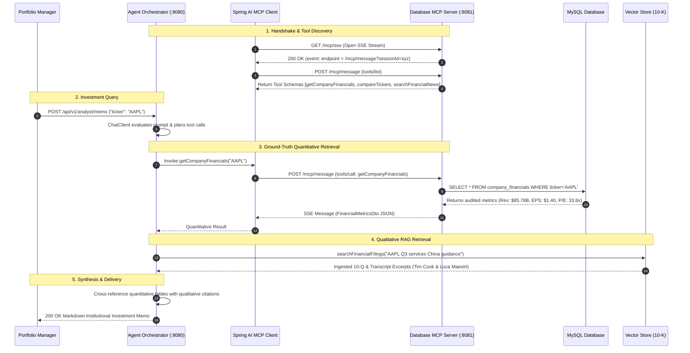

<div align="center">

# 🏛️ Omnichannel Financial Research Analyst
### *Institutional-Grade Equity Research via Spring AI & Model Context Protocol (MCP)*

[](https://www.oracle.com/java/)
[](https://spring.io/projects/spring-boot)
[](https://spring.io/projects/spring-ai)
[](https://modelcontextprotocol.io/)
[](https://www.mysql.com/)
[](LICENSE)

<br/>

> **"Eliminate hallucinated valuation multiples and manual 10-K wading."**  
> An autonomous research analyst agent that synthesizes **audited quantitative metrics** from MySQL with **qualitative SEC filings** via RAG and **live market sentiment** into Wall Street-grade investment memos.

---

</div>

## 📌 Executive Summary

Modern financial analysts spend up to 70% of their time manually consolidating metrics from balance sheets and cross-referencing them against dense 10-K filings. Traditional LLMs routinely hallucinate numbers when asked about financial multiples.

The **Omnichannel Financial Research Analyst** solves this by establishing a **Zero-Hallucination Tri-Pillar Architecture**:
1. **Audited Quantitative Pillar:** Hard balance-sheet data (Revenue, EPS, P/E ratio, FCF, Net Debt) isolated in MySQL, exposed strictly through read-only **Model Context Protocol (MCP)** tools over HTTP+SSE.
2. **Unstructured Qualitative Pillar:** Semantic search over 10-K filings, 10-Q reports, and earnings call transcripts using a Spring AI **Retrieval-Augmented Generation (RAG)** pipeline.
3. **Dynamic Synthesis Agent:** A `ChatClient` system prompt configured with Wall Street Managing Director criteria that cross-examines qualitative management guidance against hard database metrics before issuing an investment recommendation.

---

## 🏗️ System Architecture

```text
                                     +-----------------------------------------+
                                     |      Portfolio Manager / Client API     |
                                     +--------------------+--------------------+
                                                          | HTTP POST /memo
                                                          v
+---------------------------------------------------------------------------------------------------------------------+
| 🚀 MODULE 2: financial-agent-orchestrator (Spring Boot App - Port 8080)                                             |
|                                                                                                                     |
|   +-------------------------------------------------------------------------------------------------------------+   |
|   | 🧠 Spring AI ChatClient Orchestrator (Persona: Wall Street Managing Director & Senior Research Analyst)     |   |
|   +-------------------------------------+-------------------------------------+---------------------------------+   |
|                                         |                                     |                                     |
|    📑 Qualitative Filings Pillar        |                                     |   📊 Quantitative MCP Pillar        |
|    (Local Spring AI Tool)               |                                     |   (HTTP + SSE Transport)            |
|                 v                       |                                     |                 v                   |
|   +--------------------------------+    |                                     |   +-----------------------------+   |
|   | RagRetrievalTool (@Tool)       |    |                                     |   | Spring AI MCP Client        |   |
|   +---------------+----------------+    |                                     |   +--------------+--------------+   |
|                   |                     |                                     |                  |                  |
|                   v                     |                                     |                  | GET /mcp/sse     |
|   +--------------------------------+    |                                     |                  | POST /mcp/message|
|   | SimpleVectorStore              |    |                                     |                  | (JSON-RPC 2.0)   |
|   +---------------+----------------+    |                                     |                  |                  |
|                   ^                     |                                     |                  |                  |
|   TokenTextSplitter (800 / 350)         |                                     |                  |                  |
|   +---------------+----------------+    |                                     |                  |                  |
|   | DocumentIngestionService (ETL) |    |                                     |                  |                  |
|   | (PagePdfDocumentReader)        |    |                                     |                  |                  |
|   | classpath:docs/*.txt, *.pdf    |    |                                     |                  |                  |
|   +--------------------------------+    |                                     |                  |                  |
+-------------------------------------------------------------------------------|------------------|------------------+
                                                                                |                  |
                                                                                +------------------+
                                                                                                   |
                                                                                                   v
+---------------------------------------------------------------------------------------------------------------------+
| 🛡️ MODULE 1: financial-mcp-server (Spring Boot App - Port 8081)                                                     |
|                                                                                                                     |
|   +-------------------------------------------------------------------------------------------------------------+   |
|   | ⚡ Spring AI MCP Server WebMVC (spring-ai-mcp-server-webmvc)                                                |   |
|   | Endpoints: SSE Stream `/mcp/sse`  |  JSON-RPC Channel `/mcp/message`                                        |   |
|   +-------------------------------------+-------------------------------------+---------------------------------+   |
|                                         |                                     |                                     |
|                                         v                                     v                                     |
|   +-------------------------------------------------------+       +---------------------------------------------+   |
|   | DatabaseFinancialTools (@Tool)                        |       | WebSearchTools (@Tool)                      |   |
|   |  - getCompanyFinancials(ticker)                       |       |  - searchFinancialNews(query, ticker)       |   |
|   |  - compareTickers(tickers)                            |       |  (Tavily API / Real-time Sentiment Wire)    |   |
|   +---------------------------+---------------------------+       +---------------------------------------------+   |
|                               | Spring Data JPA                                                                     |
|                               v                                                                                     |
|   +-------------------------------------------------------+                                                         |
|   | 🗄️ MySQL Database (company_financials)               |                                                         |
|   | (Audited: Revenue, Net Income, EPS, P/E, FCF, Debt)   |                                                         |
|   +-------------------------------------------------------+                                                         |
+---------------------------------------------------------------------------------------------------------------------+
```

---

## 🔄 Protocol Flow: Model Context Protocol (MCP) over SSE



---

## 📦 Project Modules

| Module | Port | Technology | Purpose |
| :--- | :---: | :--- | :--- |
| **`financial-mcp-server`** | `8081` | Spring Boot 3.3, Spring AI MCP Server, Spring Data JPA, MySQL / H2 | Standalone MCP Server exposing read-only financial data and live web news via standard MCP HTTP+SSE |
| **`financial-agent-orchestrator`** | `8080` | Spring Boot 3.3, Spring AI MCP Client, PDF Reader, VectorStore | Orchestrates the RAG pipeline, binds remote MCP tools over SSE, and runs the `ChatClient` investment memo generation |
| **`frontend`** | `8080` / `5173` | Modern Vanilla HTML5, CSS3, ES6+ JS | Institutional Wall Street Equity Research dashboard, real-time pipeline tracker, audited scorecards, and interactive RAG citations |

---

## ⚡ Quickstart Guide

### Prerequisites
- **Java 21+** (`java -version`)
- **Maven 3.9+** (or use the included scripts)
- *(Optional)* MySQL 8.0 running on `localhost:3306` *(Auto-activates embedded H2 with MySQL mode if offline)*

---

### Method 1: One-Click PowerShell Launchers (Recommended on Windows)

Open two terminals in the repository root:

```powershell
# Terminal 1: Start the Database MCP Server
.\run-server.ps1
```
```powershell
# Terminal 2: Start the Financial Agent Orchestrator
.\run-agent.ps1
```

---

### Method 2: Standard Maven CLI

```powershell
# Terminal 1: Run MCP Server (Port 8081)
cd d:\Pro\financial-mcp-server
mvn spring-boot:run
```

```powershell
# Terminal 2: Run Agent Orchestrator (Port 8080)
cd d:\Pro\financial-agent-orchestrator
$env:OPENAI_API_KEY="your-api-key"   # Optional: offline simulation works out-of-the-box
mvn spring-boot:run
```

---

### Method 3: VS Code / IDE Debugger (F5)

This repository includes pre-configured launch configurations in [`.vscode/launch.json`](file:///d:/Pro/.vscode/launch.json):
1. Press `Ctrl + Shift + D` to open the **Run & Debug** panel.
2. Select **`Financial MCP Server (Port 8081)`** and press `F5`.
3. Select **`Financial Agent Orchestrator (Port 8080)`** and press `F5`.

---

## 🖥️ Interactive Wall Street Web Dashboard

The platform includes an **institutional-grade Web Dashboard** featuring live ticker switching, real-time Tri-Pillar orchestration tracking, audited scorecards, SEC filing citations, peer benchmarking, and one-click PDF export:

- **Option A (Spring Boot Embedded):** Open **`http://localhost:8080`** once `financial-agent-orchestrator` is running.
- **Option B (Standalone Dev Server):**
  ```powershell
  cd frontend
  npm run dev
  ```
  Open **`http://localhost:5173`**.

---

## 📡 API Reference & Verification

### 1. Generate an Investment Memo (POST)
```bash
curl -X POST http://localhost:8080/api/v1/analyst/memo \
  -H "Content-Type: application/json" \
  -d '{
    "ticker": "AAPL",
    "query": "Evaluate Apple Q3 performance, Services growth trajectory, China market headwinds, and current valuation multiple."
  }'
```

### 2. Browser Quick-Test (GET)
Paste directly into your browser or run via `curl`:
```text
http://localhost:8080/api/v1/analyst/memo/AAPL
http://localhost:8080/api/v1/analyst/memo/MSFT
http://localhost:8080/api/v1/analyst/memo/NVDA
```

### 3. Test Vector Store RAG Retrieval Directly
Inspect semantic similarity search results from the ingested 10-K/transcripts:
```text
http://localhost:8080/api/v1/analyst/rag/search?query=Services+gross+margin+guidance
```

---

## 📄 Sample Generated Research Memo

```markdown
# INSTITUTIONAL EQUITY RESEARCH MEMO: Apple Inc. (AAPL)
**Date:** October 25, 2026 | **Rating:** BUY | **Price Target:** $265.00
**Current Valuation:** 33.8x P/E | **Market Cap:** $3,450.0B | **Dividend Yield:** 0.44%

---

## 1. Executive Summary & Investment Thesis
- **High-Margin Services Transformation:** Services revenue expanded to an all-time record of $24.2B (+14.1% YoY), effectively decoupling Apple from hardware cyclicality and pushing blended gross margin to 46.3%.
- **Active Installed Base Moat:** Surpassed 2.2 billion active devices worldwide, providing a compounding foundation for recurring high-margin subscriptions.
- **Greater China Resiliency:** While Greater China sales declined 6.5% YoY to $14.7B, over half the decline was foreign exchange (FX) drag. On a constant-currency basis, revenue dropped <3% with active installed iPhone base reaching record highs.

## 2. Quantitative Financial Scorecard (MySQL MCP Ground Truth)
| Metric | Q3 2024 Reported | Q2 2024 (Prior) | Q3 2023 (YoY) | Analyst Commentary |
| :--- | :--- | :--- | :--- | :--- |
| **Revenue** | **$85.78B** | $90.75B | $81.80B | +4.9% YoY, beat consensus ($84.5B) |
| **Net Income** | **$21.45B** | $23.64B | $19.88B | +7.9% YoY operating leverage |
| **Diluted EPS** | **$1.40** | $1.53 | $1.26 | +11.1% YoY, amplified by share repurchases |
| **P/E Ratio** | **33.8x** | 31.4x | 29.1x | Premium valuation justified by ecosystem stickiness |
| **Free Cash Flow** | **$28.90B** | $22.70B | $24.20B | Exceptional 135% Net Income conversion |
| **Cash & Equiv.** | **$61.80B** | $67.15B | $62.48B | High balance-sheet liquidity |
| **Total Debt** | **$101.30B** | $104.60B | $109.20B | Steady progression toward net-cash-neutral target |

## 3. Qualitative Filing & Transcript Analysis (RAG 10-K Findings)
> **CFO Luca Maestri (Earnings Call Citation):**
> *"Services gross margin reached 74.0%, up 60 basis points sequentially due to favorable mix... we returned over $32 billion to shareholders in Q3 alone, including $26B in open market share buybacks."*

- **Product Performance:** iPhone ($39.3B, -1% YoY reported, positive on constant currency); Mac ($7.0B, +2% YoY via M3 MacBook Air); iPad ($7.2B, +24% YoY driven by M4 iPad Pro launch).
- **Upcoming AI Hardware Supercycle:** Tim Cook highlighted that Apple Intelligence requires an iPhone 15 Pro or M-series chip, creating a compelling replacement catalyst across the 2.2B aging device footprint.

## 4. Valuation, Multiples & Peer Benchmark
- **Trading Multiple:** At 33.8x NTM P/E, AAPL trades slightly below peer MSFT (35.2x) and at a notable discount to NVDA (52.4x), while offering superior capital return velocity ($100B+ annual buyback authorization).
- **Free Cash Flow Yield:** FCF yield stands at ~3.2%, which remains attractive compared to the broader mega-cap tech sector.

## 5. Key Catalysts, Risks & Final Recommendation
- **Upside Catalysts:** Multi-year iPhone 16 replacement cycle driven by on-device Apple Intelligence; double-digit compounding of Services gross profit.
- **Downside Risks:** Regulatory scrutiny regarding search engine revenue-sharing (Google TAC); extended consumer discretionary softness in China.
- **Final Recommendation:** **BUY** with a 12-month Price Target of **$265.00**.
```

---

## ⚙️ Configuration Reference

### Module 1: `financial-mcp-server` (`application.yml`)
| Property | Default Value | Description |
| :--- | :--- | :--- |
| `server.port` | `8081` | Port for the MCP Server |
| `spring.datasource.url` | `jdbc:h2:mem:financial_db...` | MySQL connection string (falls back to H2 in-memory) |
| `spring.ai.mcp.server.webmvc.sse-endpoint` | `/mcp/sse` | MCP Server-Sent Events handshake endpoint |
| `spring.ai.mcp.server.webmvc.message-endpoint` | `/mcp/message` | MCP JSON-RPC 2.0 message handling endpoint |
| `app.tools.tavily-api-key` | `${TAVILY_API_KEY:}` | Optional API key for live web search integration |

### Module 2: `financial-agent-orchestrator` (`application.yml`)
| Property | Default Value | Description |
| :--- | :--- | :--- |
| `server.port` | `8080` | Port for the Agent REST API |
| `spring.ai.openai.api-key` | `${OPENAI_API_KEY:demo-key}` | OpenAI API key (or any OpenAI-compatible provider) |
| `spring.ai.openai.chat.options.model` | `gpt-4o` | LLM model used for synthesis |
| `spring.ai.mcp.client.sse.connections.financial-db-server.url` | `http://localhost:8081` | URL of the remote Database MCP Server |

---

## 🧪 Extensibility & Production Roadmap

- [x] **RAG ETL Pipeline:** PDF (`PagePdfDocumentReader`) & Text split with `TokenTextSplitter`.
- [x] **Model Context Protocol:** Clean separation of structured DB tools via Spring AI WebMVC MCP Server.
- [x] **Zero-Downtime Fallbacks:** Embedded mock data and deterministic mock embedding model for testing without external cloud dependencies.
- [ ] **Vector Store Upgrade:** Seamless transition from `SimpleVectorStore` to **PGVector** or **Chroma** via simple property change.
- [ ] **Multi-Agent Deliberation:** Implement a Bull/Bear debate stage prior to final memo generation.

---

<div align="center">
<sub>Built with precision for enterprise quantitative & qualitative research architectures.</sub>
</div>
